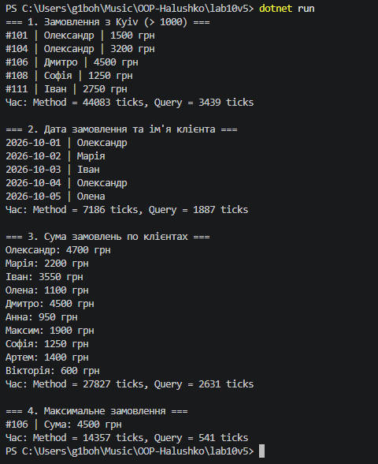

# Лабораторна робота №10 (Варіант 5 — Управління замовленнями)

**Тема:** LINQ в дії: фільтри, join, агрегації. Продуктивність.

**Мета:** Навчитися ефективно використовувати LINQ для фільтрації, об'єднання (join) та агрегації даних, а також аналізувати продуктивність LINQ-запитів.

---

## Опис реалізації та аналіз продуктивності

У проєкті створено дві сутності: `Customer` (10 записів) та `Order` (12 записів). Для кожного з 4-х завдань варіанту реалізовано два варіанти запитів (Method Syntax та Query Syntax) із вимірюванням часу виконання через `Stopwatch`.

**Висновки щодо продуктивності:**
1. Синтаксис запитів (Query Syntax) і синтаксис методів (Method Syntax) компілюються в однаковий IL-код, тому їхня швидкодія ідентична (різниця у тіках при першому виклику зумовлена лише JIT-компіляцією та розігрівом кешу).
2. Найдорожчими за часом виконання є операції **об'єднання та групування (`Join` / `GroupJoin`)** та **сортування (`OrderByDescending`)**, оскільки вони вимагають побудови внутрішніх хеш-таблиць або повного проходу по обох колекціях (`O(N + M)` або `O(N log N)`), тоді як проста лінійна фільтрація працює швидше.

---

## Результат виконання програми

---

