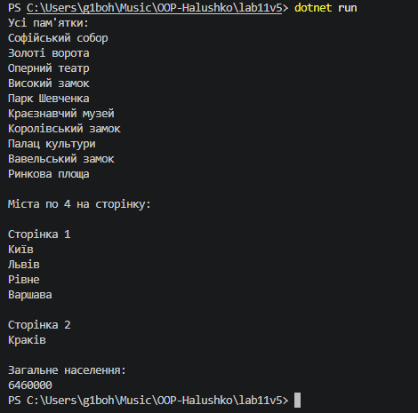

# Лабораторна робота №11 (Варіант 5)

**Тема:** LINQ: SelectMany, пагінація й custom extensions.

**Мета:**  Навчитися використовувати SelectMany для роботи з вкладеними колекціями, реалізовувати пагінацію та створювати власні методи розширення.

---

## Хід роботи

У ході виконання лабораторної роботи я створив консольний проєкт lab11v5 і реалізував роботу з країнами, містами та пам'ятками відповідно до варіанту 5:
- SelectMany використано для отримання всіх пам'яток усіх міст в одному списку.
- Skip() і Take() застосовано для виведення міст по 4 на сторінку.
- TotalPopulation() використано для підрахунку загального населення всіх міст.
---

## Результат виконання програми

---