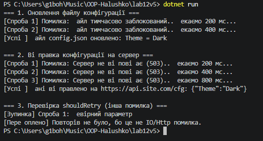

# Лабораторна робота №12 (Варіант 5 — Оновлення конфігурації)

**Тема:** Обробка I/O / мережевих помилок та патерн Retry.

**Мета:** Навчитися обробляти типові помилки вводу/виводу та мережеві помилки за допомогою блоків try-catch-finally, а також реалізувати патерн Retry для підвищення відмовостійкості застосунків.

---

## Хід роботи та висновок

У ході виконання лабораторної роботи створено консольний проєкт `lab12v5`, де реалізовано класи `FileProcessor`, `NetworkClient` та узагальнений `RetryHelper`. 

**Висновок про роботу експоненційної затримки:** Затримка перед кожною наступною повторною спробою обчислюється за формулою `initialDelay * 2^(attempt - 1)` (наприклад, 200 мс -> 400 мс -> 800 мс). Це дозволяє зменшити навантаження на перевантажений сервер або заблокований файл, даючи системі більше часу на відновлення працездатності перед наступним запитом.

---

## Результат виконання програми

---

