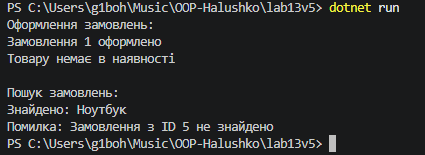

# Лабораторна робота №13 (Варіант 5 — Управління замовленнями)

**Тема:** Власні винятки та патерн Result.

**Мета:** Навчитися створювати власні типи винятків для обробки помилок, а також використовувати патерн Result для повернення результатів операцій без використання винятків у звичайних ситуаціях.

---

## Хід роботи та висновок

У ході виконання лабораторної роботи створено консольний проєкт `lab13v5`, де реалізовано класи `OrderNotFoundException`, `Result<T>`, `Order` та `OrderService`. Метод `GetOrder()` використано для пошуку замовлень, а `PlaceOrder()` — для їх оформлення з перевіркою наявності товару.

**Висновок:** Власний виняток `OrderNotFoundException` дозволяє обробляти ситуацію, коли замовлення не знайдено. Патерн `Result<T>` зручний для перевірки наявності товару, оскільки дозволяє повернути результат або повідомлення про помилку без використання винятків.

---

## Результат виконання програми

---

