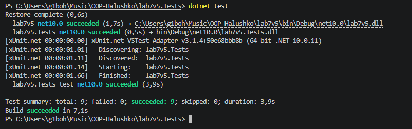

# Лабораторна робота №7 (Варіант 5 — Customer)

**Тема:** Узагальнені типи (Generics). IRepository з where-обмеженнями та тестами.

**Мета:** Навчитися створювати узагальнені інтерфейси та класи, застосовувати where-обмеження для типів-параметрів, а також розробляти юніт-тести для перевірки коректності узагальнених реалізацій.

---

## Структура проєкту

Проєкт розділено на два окремих модулі:
1. `lab7v5` — основна бібліотека/консольний додаток:
   - `IEntity` — інтерфейс сутності з базовою властивістю `Id`.
   - `Customer` — сутність клієнта (`FirstName`, `LastName`, `Address`), що реалізує `IEntity`.
   - `IRepository<T>` — узагальнений інтерфейс репозиторію з обмеженням `where T : IEntity`.
   - `InMemoryRepository<T>` — реалізація репозиторію в пам'яті для CRUD-операцій.
2. `lab7v5.Tests` — тестовий проєкт на базі xUnit, що повністю покриває перевірками функціонал репозиторію.

---

## Результати виконання юніт-тестів (dotnet test)

