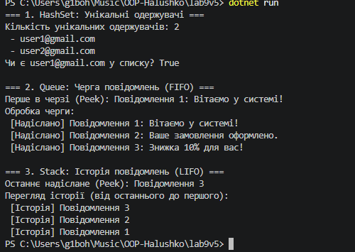

# Лабораторна робота №9 (Варіант 5 — Система повідомлень)

**Тема:** HashSet/Queue/Stack: практичні сценарії.

**Мета:** Навчитися використовувати спеціалізовані колекції HashSet<T>, Queue<T>, Stack<T> для розв'язання практичних задач, зрозуміти їхні особливості та сценарії застосування.

---

## Хід роботи

У ході виконання лабораторної роботи я створив консольний проєкт `lab9v5` і реалізував систему повідомлень відповідно до варіанту 5:
- `HashSet<string>` використано для збереження унікальних email-адрес одержувачів (автоматичне ігнорування дублікатів).
- `Queue<string>` застосовано для черги повідомлень на відправку з дисципліною FIFO (First In, First Out).
- `Stack<string>` використано для збереження історії надісланих повідомлень з дисципліною LIFO (Last In, First Out).

---

## Результат виконання програми

---

